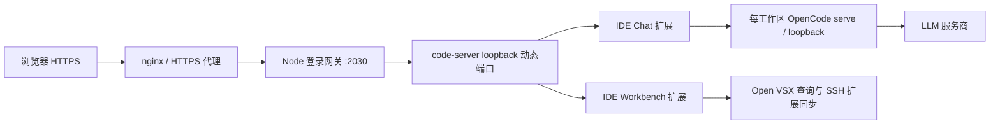

# 架构

## 组成与依赖

本仓库包含 WebUI 网关、两个 VS Code 扩展及完整构建脚本。`opencode-extension/` 是普通源码目录，不是子模块。构建需要下载 npm/Bun 依赖；运行依赖本机 Node.js、Python 3、code-server 和 OpenCode CLI。部署需要 Linux/systemd；没有要求预先运行另一个 code-server 服务。



| 模块 | 责任 |
| --- | --- |
| `scripts/start.mjs` | 读取登录哈希、隐藏 Accounts、启动私有 code-server 和公开认证网关，转发退出信号 |
| `scripts/auth.mjs` | 登录、12 小时 Cookie 会话、登出、HTTP/WS 转发、Origin 校验与登录限流 |
| `ide-integration/` | 单编辑区默认布局、项目导航、按需结果预览、扩展同步入口 |
| `opencode-extension/` | OpenCode 进程、SDK、事件流、会话、聊天、权限/问题、模型和配置页 |
| `scripts/build.mjs` | 独立构建两个扩展并生成本地 VSIX |
| `scripts/deploy-service.sh` | 系统服务部署、凭据导入、隔离扩展安装、更新和健康检查 |

两个扩展 ID 分别为 `opencode-ide.opencode-ide-chat`、`opencode-ide.opencode-ide-integration`，Workbench 依赖 Chat。命令和设置前缀分别为 `opencode-ide-chat.*`、`opencode-ide.*`。

## UI 与会话

默认中间只有一个原生编辑组，左侧 Explorer 关闭但可以重新打开。Terminal、Output、Problems 使用原生底部面板。选择 PDF、图片等结果文件后，在当前组由对应扩展打开；不自动创建空结果区。

右侧 Secondary Sidebar 提供五个原生标签：OpenCode、Sessions、Todo、Subagents、Modified Files。窄侧栏通过原生溢出菜单显示其余标签。各模块标题栏都有 Quick New Session 和 Settings；Settings 打开独立设置页面，不属于右侧标签。聊天打开、新建、切换和分支均路由到右侧。

每个工作区目录由 Chat 扩展管理一个 `opencode serve`。SDK 调用保留 `directory`，会话引用包括 `workspaceId + dir + sessionId`。服务事件经 SSE、reducer 和 Webview 消息桥更新界面。Todo、Diff 和 Subagents 使用 focused session 状态，不另建一套任务记录。

默认布局只在初始化或版本迁移时设置；显式 Restore Default Layout 恢复单编辑区。扩展还周期保存编辑布局和源码 URI，刷新时可补回丢失的源码编辑器。原生布局仍可由用户移动，不是锁定的自定义浏览器外壳。

## 登录与数据

- 公开网关默认绑定 `0.0.0.0:2030`，code-server 只监听 loopback 动态端口。
- `config/ide-login.json` 在部署时读取；`data/auth.json` 保存 scrypt 盐和哈希，文件权限 `0600`。网关不保存明文密码。
- 登录签发 HttpOnly、SameSite=Lax Cookie，HTTPS 转发时带 Secure。会话在网关内存中，重启后需重新登录。
- HTTP/WS 请求均校验登录，WS 还校验 Origin。`/healthz` 是公开的网关存活探针，不证明 OpenCode/LLM 已就绪。`/logout` 清除当前登录。
- HTTPS 由外部代理提供，须保留 Host 的端口并覆盖 `X-Forwarded-*`，转发 WebSocket；非 localhost 的普通 HTTP 不足以运行 Webview Service Worker。
- Accounts 的隐藏是专属 code-server 用户数据的 profile storage 更新，不是删除 GitHub/Microsoft 身份认证实现。

安装目录结构：

```text
~/opencode-ide/
  start-service.sh, opencode-ide.service, deployment.json
  scripts/, config/, docs/, artifacts/, examples/
  data/
    auth.json, code-server.yaml
    user-data/                 # 设置、布局、扩展状态、日志
    extensions/                # WebUI 扩展，与 Remote SSH 目录独立
    extension-sync.json        # 两侧已同步版本/删除基线
```

模型设置更新所选工作区的 `opencode.json` 或 `opencode.jsonc`，保留未修改的字段和注释。API Key 经 OpenCode Auth API 保存，不回传到表单。配置保存后由用户在任务结束时重启工作区服务。

WebUI 登录、OpenCode 服务商凭据和 VS Code Accounts 是不同概念。OpenCode CLI 的全局凭据/会话仍可能与同一系统用户的其他 OpenCode 客户端共享；仓库独立并不意味着这些数据自动隔离。

## 扩展同步

只处理同服务器、同用户的 VS Code Remote SSH，自动发现 `~/.vscode-server` 或 `VSCODE_AGENT_FOLDER`，不操作桌面客户端的本地扩展。

1. 激活、扩展变更、每 15 秒检查以及 Sync Open VSX Extensions 按钮触发同步。刷新会重新激活/检查。
2. 读取两侧 `extensions.json` 与包信息。目录暂时不可读时中止，不解释为全部卸载。
3. 查询 Open VSX 的扩展 **ID** 是否有可下载条目，不按发布者判断；包含 `ms-*`。成功缓存 1 小时，未收录缓存 5 分钟，网络错误不改基线。
4. 同步使用当前服务器已安装的包和版本重新打包 VSIX，由目标 CLI 安装。**不从 Open VSX 下载指定版本，也不证明每个本地版本都在该市场发布**。检查目标 Code 引擎版本和依赖，不能保证所有原生二进制或平台差异兼容。
5. 首次合并取较新版本；之后按变化的一侧传播安装、版本变更或卸载。两侧同时改版本时使用安装时间，删除/更新冲突优先删除。
6. 通过跨窗口锁和原子同步状态文件避免重入。依赖未满足、网络或安装失败会跳过，记录到 OpenCode IDE Output，下轮重试。

`opencode-ide.opencode-ide-chat`、`opencode-ide.opencode-ide-integration` 和旧 `meishan.opencode-enhanced-ui` 不参与同步，包括旧基线记录。部署中清理旧 ID 仅限专属 WebUI 扩展目录。

## 原型与实现边界

[prototype.html](../reference/prototype.html) 是无后端的交互布局示意，用于展示五标签、按需结果和设置入口，不启动服务、不保存真实凭据、不调用模型、不执行代码。实际网页由 code-server 提供。

默认示例 `examples/python-demo` 用 Python 标准库生成 JSON 和 HTML 报告，无需额外语言插件。模型请求、工具权限、实际文件修改和特定扩展兼容性需在目标环境单独验收。可复现检查及已知失败见 [testing.md](testing.md)。
